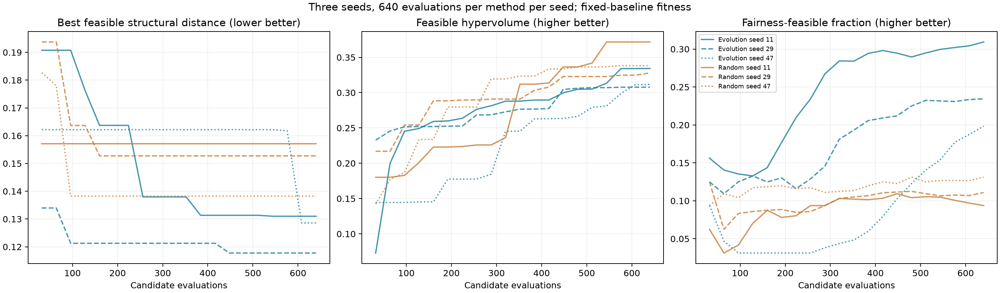
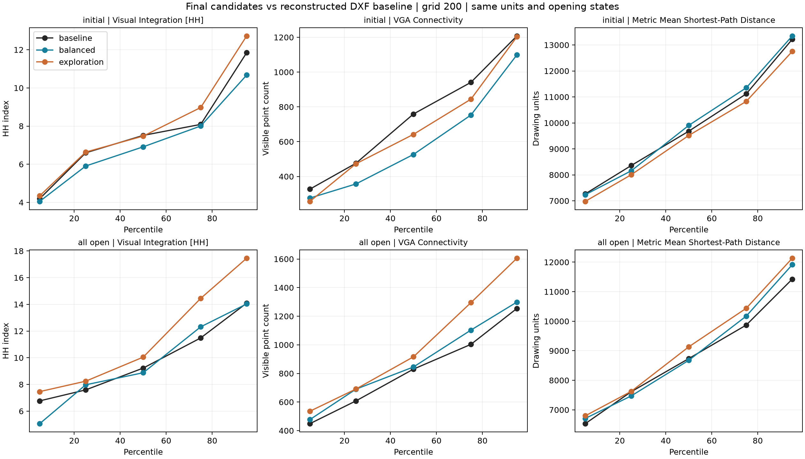
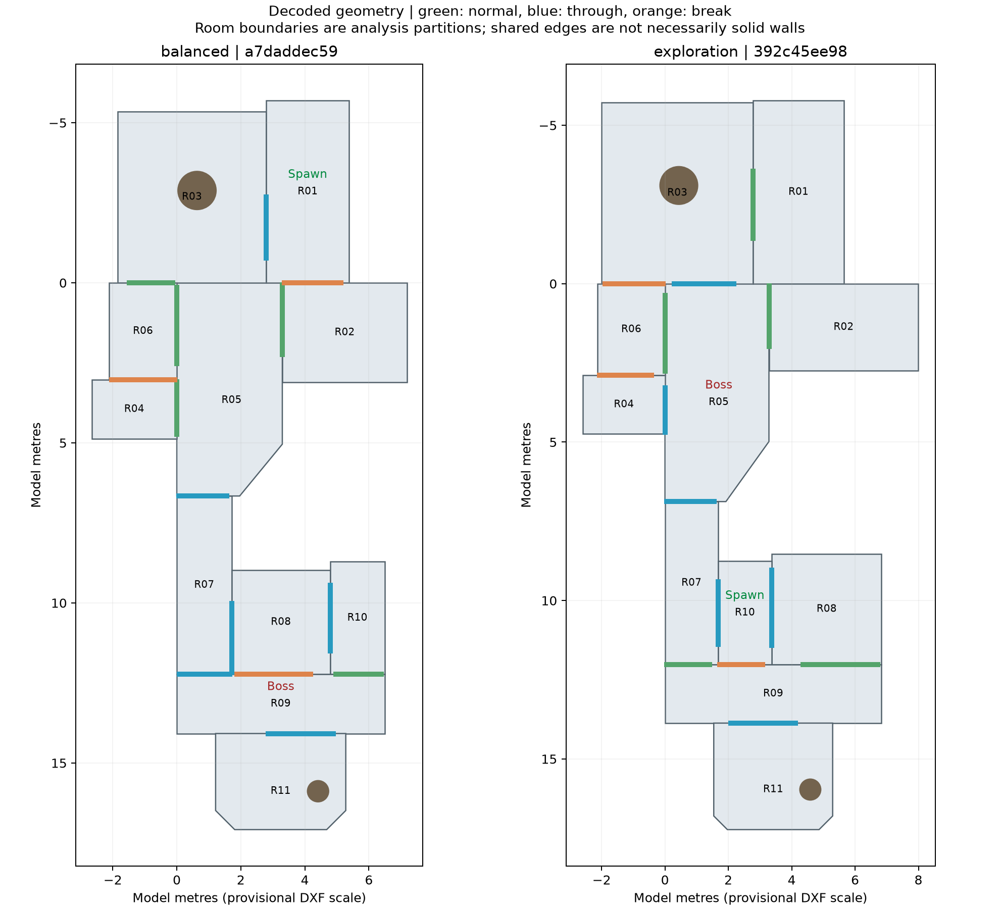

# 鼠王关搜索式 PCG：完整实验结果

三组进化与三组等预算随机对照均已完成，每组 640 次评价，共 3840 次。所有评价使用同一配准、尺度、网格和实现版本；原 graph/DXF 哈希未变。

|方法|种子|满足公平性约束|最佳结构距离↓|最佳压力损失↓|最大路线多样性↑|
|---|---:|---:|---:|---:|---:|
|evolution|11|198/640|0.130998|0.073611|0.460606|
|evolution|29|150/640|0.117766|0.100670|0.409524|
|evolution|47|127/640|0.128586|0.133333|0.460606|
|random|11|60/640|0.157140|0.004762|0.547475|
|random|29|71/640|0.152735|0.017172|0.463636|
|random|47|84/640|0.138239|0.041228|0.464394|

各列极值可能来自不同候选，不能拼成一张同时达到全部最优的关卡。仅三组随机种子，不作总体显著性或全局最优结论。

## 指标与验收边界

- 结构分数对照的是统一初始/全开条件下重算的鼠王关 DXF 模型。历史 graph 与重算值存在差异，详见 ../../baseline/calibration_200.json。
- Gate Counts 与 Convex Choice 没有进入适应度：前者生成参数未核实，后者重算一致性未建立。
- 体验分数来自三种二维追逐代理。独立扰动、200 单位精网格和 Godot 真实穿门分别复核，不能替代真人试玩。
- 中期发现了短时间逃脱/接近捕获阈值的候选。新增独立公平性验收属于事后筛查，完整记录见 heldout_export_review.json；未通过者不作为推荐预设。
- 图中的超体积是事后汇报统计，固定参考点为 [1,1,1,0]，只计入框内的可行点，不是搜索评分。

## 下一步游戏设计验证

以同一角色参数让玩家交叉顺序试玩基准白模与通过最终验收的候选，记录死亡、卡住、逃生选择、压力和公平性感受。对过短逃脱路线、过早捕获阈值和绕圈策略先校准，再建立版本隔离的新评价规则；不要在当前实验中途改分后混排。

## 最终候选与验收（2026-11-19）

最终交付 2 个不同布局。balanced 和 pressure 指向同一个候选；exploration 是另一个候选，不虚报为三个不同方案。

|预设|候选 ID 前缀|精网格结构距离↓|压力损失↓|路线多样性↑|独立测试逃脱|
|---|---|---:|---:|---:|---:|
|balanced|a7daddec59a6|0.114805|0.294574|0.409524|66.7%|
|exploration|392c45ee9822|0.167928|0.428571|0.421818|100.0%|

- 两个布局共 18 个 through/break 通道均通过初始阻挡、Boss 撞开和实际穿越测试。
- Godot 全部撞开状态：玩家与 Boss 均可到达全部 11 个空间。初始玩家导航结果不包含显式挤身交互，不能误读为玩家不可达。
- 破坏过程检查：2 个布局，每个检查初始状态及依门 ID 逐一开放的状态；这是构造的测试顺序，不是观测到的 Boss 行为。
- 200 单位精网格与独立追逐验收通过；5 项回归测试通过；原 DXF/graph 与评价实现哈希复核通过。
- Main 已重新从磁盘打开，最终预设可见，场景保存后脚本哈希不变，手动 seed 94 保留。

## 使用交付
打开 Godot 的 scenes/Main.tscn，在根节点选择 Evolution Preset：Balanced、Exploration 或 Pressure；F6 运行当前场景。Pressure 目前复用 Balanced。
候选参数保存在 data/evolution/*.json；完整评价在 evolution/cache；独立验收记录见 evolution/acceptance.json、candidate_navigation.json 与本目录 destruction_states.json。

进化搜索的三组最佳结构距离均优于等预算随机对照，可行产出为 475/1920（24.7%），随机为 215/1920（11.2%）。但随机对照在压力、多样性极值及当前参考框下的最终超体积上更好，因此不能声称进化全面优于随机，更不能声称游戏体验已超过官方关卡。

当前完成的是首轮搜索与白模技术验收。真人交叉试玩、完整战斗阶段，以及经验证后的 Gate Counts/Convex 适应度属于后续研究；历史指标仍保留，不用代理值冒充。
